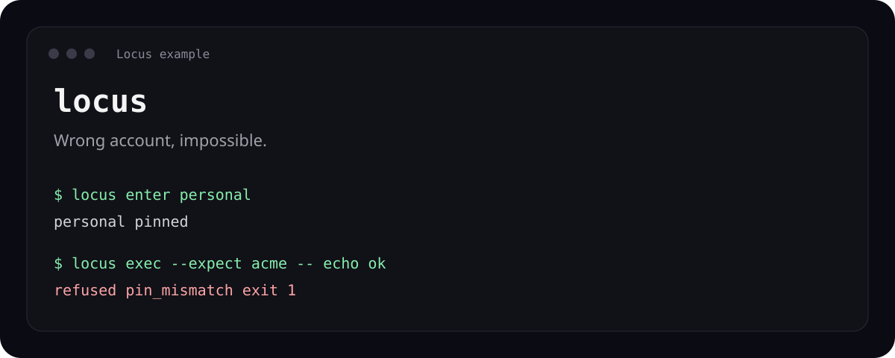
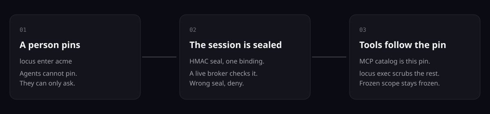
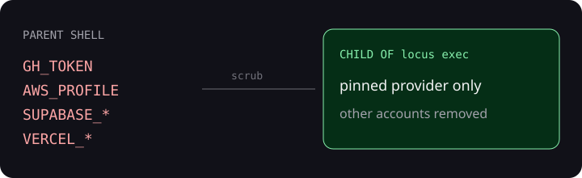
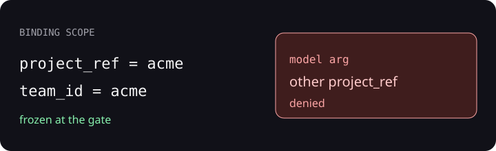

# Locus



**Your coding agent can't act as the wrong account.**

Locus is the identity plane for coding agents. You pin one client. After that, the CLI, the MCP tools, and the local dashboard act only as that client until a person pins again.

That matters on a machine with more than one client. Ambient `gh auth`, a shared Supabase token, or the last Vercel team can send an agent to the wrong account. A pin makes the other account unavailable.

Agents are first-class users. Start with the commands below. Machine indexes: [llms.txt](./llms.txt), [llms-full.txt](./llms-full.txt), and the [agent contract](./docs/agent-contract.md).

[For agents](#for-agents) ·
[30-second start](#30-second-start) ·
[How it works](#how-it-works) ·
[Install](#install-options) ·
[FAQ](#faq) ·
[Star](#star-locus)

<!-- fresh:begin badge -->
[](https://github.com/ashlrai/locus/releases/tag/v0.6.2)
<!-- fresh:end -->
[](https://github.com/ashlrai/locus/actions/workflows/ci.yml)
[](https://www.npmjs.com/package/locus-cli)
[](./LICENSE)
[](./rust-toolchain.toml)

<!-- fresh:begin release -->
Latest release: [v0.6.2](https://github.com/ashlrai/locus/releases/tag/v0.6.2) (2026-11-01).

npm package READMEs use version-neutral installation commands to avoid stale pinned releases.
<!-- fresh:end -->

## For agents

One command installs both binaries:

```bash
npm install -g locus-cli @ashlrai/locus-mcp
```

Homebrew and Cargo are in [Install options](#install-options). At the v0.6.2 release, the live Homebrew tap installs v0.6.1, so use npm for v0.6.2.

Read state as JSON. The first key is `schema`. Failures on stderr use `locus.error.v1`. No command prints a secret.

```bash
locus whoami --json
locus status --json
locus doctor --json
locus version --json
locus topic agent-contract --json
```

`locus doctor --json` can exit 0 while `verdict` is `WARN` and `ok` is false. Exit 0 means the findings are setup advice, not that setup is finished.

Print the MCP entries without writing a client config:

```bash
locus setup --client claude --print
locus setup --client cursor --print
locus setup --client codex --print
```

Those entries launch `locus-mcp` and serve control tools only. For the pinned binding's provider tools, paste the supervised server below. Launch the client from the shell that ran `locus hook` and `locus enter`. Restart the client after a re-pin. Agents cannot pin. Ask a person.

Claude Code (`.mcp.json`) and Cursor (`~/.cursor/mcp.json`):

```json
{ "mcpServers": { "locus": { "command": "locus", "args": ["mcp", "--supervised"] } } }
```

Codex (`~/.codex/config.toml`):

```toml
[mcp_servers.locus]
command = "locus"
args = ["mcp", "--supervised"]
```

Same paste, by hand, if the client CLIs are installed:

```bash
claude mcp add locus -- locus mcp --supervised
codex mcp add locus -- locus mcp --supervised
```

More copy-paste blocks: [docs/copy-paste.md](./docs/copy-paste.md). Rules for agents in this repo: [AGENTS.md](./AGENTS.md).

## 30-second start

Run this in one shell. It creates sample bindings, pins `personal`, and checks that `acme` is refused. `LOCUS_HOME` keeps the trial off your real `~/.locus`.

```bash
export LOCUS_HOME="$(mktemp -d)"        # omit this line to use ~/.locus
npm install -g locus-cli @ashlrai/locus-mcp   # or brew or cargo; see Install options
locus quickstart                        # sample bindings, pin, whoami, doctor
eval "$(locus hook zsh)"                # or bash; exports the control capability
locus enter personal                    # pin from this shell (it supervises the pin)
locus whoami                            # who your agents are acting as, right now
locus exec --expect personal --no-resolve -- echo ok # runs: personal is pinned
locus exec --expect acme -- echo ok     # refused, exit 1, child never starts (pin_mismatch)
```

The `echo` check uses `--no-resolve` because it needs no credentials. `quickstart` does not replace bindings you already have. `--no-resolve` refuses bindings whose upstreams resolve credentials. For real provider work, supply credentials outside the agent and replace the sample scopes. See the [sample exec walkthrough](examples/sample-exec-q8.md).

Same shell, machine output:

```bash
locus whoami --json
locus status --json
locus doctor --json
```

What the extra steps are for:

- **Control capability.** `enter`, `pin`, `leave`, and `exec` need `LOCUS_CONTROL_CAPABILITY`. `locus quickstart` mints it and saves it at `~/.locus/control_capability` (mode 0600, respects `LOCUS_HOME`). `eval "$(locus hook zsh)"` exports it and does not print it. Without it, `locus exec` stops with `LOCUS_CONTROL_CAPABILITY is required for control-plane authority`. `locus capability status` shows the posture and not the value.
- **Broker.** The shell that pins supervises an authority broker. `locus enter personal` works after `quickstart`, including when quickstart ran in a shell that has already exited.
- **Recovery.** If the next command says `human re-pin required` or `no current broker endpoint`, use [Recovering after the broker exits](#recovering-after-the-broker-exits).


## How it works



```text
locus enter acme
        |
        v
  Session sealed (HMAC) to binding "acme"
        |
        +--> locus mcp --supervised
        |      tools = this binding only
        |      agents cannot pin (locus_request_pin only)
        |
        +--> locus exec -- <cmd>
               scrubs ambient GH_TOKEN, AWS_*, SUPABASE_*, VERCEL_*
               injects only this binding's env: refs
               private GH and AWS config under the session worker home
```

| Approach | Where identity lives | What a switch reaches |
|---|---|---|
| `gh auth switch` | gh's shared config | Every process that reads that config |
| direnv `.envrc` | Variables exported on `cd` | Only the variables in that file |
| 1Password `op run` | Refs resolved for one command | That command |
| Locus `enter` / `exec` / `run` | A sealed session for one binding | That command or session. Other accounts are scrubbed. A directory `.locus.toml` can refuse other bindings. |

Credential refs in a binding are pointers, never raw tokens.

| Ref | What happens |
|-----|------------|
| `env:VAR` | The parent supplies the variable. Locus injects it only into the pinned provider's child. |
| `phm:NAME` | Readable for metadata. Resolution fails closed until a scoped bridge exists. |

`test:` refs exist only in compiled unit tests. Production binaries reject them. Details: [credential compatibility](./docs/credential-compatibility.md).

## Features

### One pin is the only account


Unpinned sessions get control tools only. There is no fallthrough to a personal account. `locus_request_pin` asks a person to pin. It does not pin.

### The child does not inherit the other client



`locus exec`, `locus run`, and `locus ci run` scrub ambient identity. `locus exec --for gh` passes only the pinned GitHub credential into a fresh private config. See [CLI routing](docs/cli-routing.md).

### Frozen ids stay frozen



The model cannot override a frozen `project_ref`, `team_id`, org, or repo. Destructive names can require approval. A local `locus approve grant` label is advice. It does not release provider execution. See [policy](./docs/policy.md).

## Measured reach of the wrong client's credentials

The shell still holds another client's ambient credentials, and a child process starts. Reproduce with `python3 eval/env-reachability/redteam.py` (needs `locus` 0.5.0 on `PATH`, fake canary credentials, throwaway `HOME` and `LOCUS_HOME`). This table is that run. It is not a new measurement.

| launch | env credentials reachable (16 variables, 3 trials) |
| --- | --- |
| plain launch | 48 of 48 |
| `locus run -b acme -- <cmd>` | 0 of 48 |

With locus, credential files read through `$HOME` (`~/.config/gh/hosts.yml`, `~/.aws/credentials`, `~/.netrc`, `~/.git-credentials`, `~/.npmrc`) were not reachable (0 of 15). An agent attempt to pin a binding was refused (3 of 3).

This is not a sandbox. The same files opened by their real absolute path stayed reachable (15 of 15, same as a plain launch). Locus scrubs the environment and redirects `HOME`. It does not stop a process from opening a file the operating system already allows. Scripted adversary, one machine, locus 0.5.0, 3 trials, no external audit.

## FAQ

### Can an agent change the pin?

No. Pin changes are a human control command (`locus enter`, `locus pin`, `locus switch`). MCP exposes `locus_request_pin` only. If the tools are the wrong tenant, ask a person to pin. Do not invent another `project_ref`.

### Where do secrets go?

Bindings store `env:VAR` and `phm:NAME`. They do not store raw tokens. MCP results can show scopes and aliases. They do not return resolved values. `phm:` resolution fails closed in this checkout. See [credential compatibility](./docs/credential-compatibility.md).

### Is Locus a sandbox?

No. It scrubs the child environment and redirects `HOME`. A process can still open a file by an absolute path it is allowed to read. See the measured section above.

### What does the json flag print?

One JSON object whose first key is `schema`, for example `locus.whoami.v1` or `locus.plan.v1`. List commands print a JSON array and are not stamped. The field list is `locus topic agent-contract --json`. Guide: [docs/agent-contract.md](./docs/agent-contract.md).

### How do Claude, Cursor, and Codex connect?

Paste the supervised snippet in [For agents](#for-agents), from the shell that is already pinned. `locus setup --client claude --print` (and `cursor` or `codex`) prints the control-tools entry and writes nothing. Provider tools need `locus mcp --supervised`. Full notes: [docs/mcp.md](./docs/mcp.md).

### What if the broker is gone?

Open a new shell, load the hook, and `locus enter` the same alias. Steps: [Recovering after the broker exits](#recovering-after-the-broker-exits).

## Star Locus

If a pin kept an agent on the right account, star the repo so the next person can find it.

[Star ashlrai/locus](https://github.com/ashlrai/locus/stargazers)

## Install options

Homebrew, npm, and Cargo are the current installation options. At the v0.6.2
release, the live Homebrew tap installs v0.6.1; use npm for v0.6.2.
The v0.6.2 npm wrappers fail closed if a release checksum sidecar is missing,
unparseable, unreachable or mismatched; a checksum failure does not fall back
to Cargo. Earlier v0.6.0 wrappers could install without verification on a
missing or unparseable sidecar and could fall back to Cargo on a mismatch.
Checksums detect corruption, not publisher authenticity. See the
[CLI wrapper notes](./npm/README.md) and [MCP wrapper notes](./npm-mcp/README.md).

```bash
# Homebrew (tap live). Installs both binaries
brew install ashlrai/tap/locus

# npm (release binary, or cargo if this platform has no asset)
npm install -g locus-cli @ashlrai/locus-mcp
npx locus-cli --help
npx @ashlrai/locus-mcp   # MCP server for Claude Code / Cursor
```

### Proposed shell installer

[Issue #169](https://github.com/ashlrai/locus/issues/169) proposes a
one-command installation path for machines without npm or Rust. The repository
contains an [installer implementation](./scripts/install.sh), but this proposal
does not establish that a published one-command installation path or matching
assets are available for every release. Use the current options above or the
source install below in the meantime.

The intended installer selects a platform-specific `locus-<target>.tar.gz`
release archive and its required `.sha256` sidecar, verifies the archive, and
installs both `locus` and `locus-mcp`. Missing or mismatched checksums must stop
installation before binaries are replaced; checksums detect corruption but are
not publisher signatures. The implementation targets macOS Apple Silicon and
Intel, and Linux x86_64 with glibc. On unsupported platforms, including Linux
ARM, try a source install. It requires Bash, curl, tar, and `sha256sum` or `shasum`;
its default destination is `~/.local/bin`, without sudo or shell profile edits.
Users must add the destination to their `PATH` themselves.
See the [installer platform matrix](./docs/installer-platform-matrix.md) for
prerequisites, evidence limits, and unresolved platform decisions.

### Install from source

The minimum supported Rust version (MSRV) for source installs, including npm's
Cargo fallback, is **Rust 1.89 or newer**, with a matching Cargo toolchain. The
[workspace manifest](./Cargo.toml) declares this as `rust-version` for all crates.
See the [MSRV guide](./docs/MSRV.md) for verification and upgrade instructions.
With Rust 1.83, installation fails before compiling Locus because the locked
`idna_adapter` dependency uses the 2024 edition, which that Cargo cannot parse
([issue #167](https://github.com/ashlrai/locus/issues/167)). Cargo 1.85 through
1.88 can parse it but reject the workspace's minimum Rust version.

Check the active toolchain before installing:

```bash
rustc --version
cargo --version
```

If necessary, update and select a supported toolchain with `rustup update stable`
and `rustup default stable`. A checkout's `rust-toolchain.toml` selects stable
inside the checkout, but it does not select the toolchain for `cargo install
--git` run elsewhere. Check the versions in the directory where you install.

```bash
# Install both binaries from Git
export PATH="$HOME/.cargo/bin:$PATH"
cargo install --git https://github.com/ashlrai/locus locus-cli --locked
```

Or install from a local checkout:

```bash
export PATH="$HOME/.cargo/bin:$PATH"
cargo install --locked --path crates/locus-cli
```

Homebrew formula (for taps): [integrations/homebrew](./integrations/homebrew).

## CLI

```
locus init [--with-samples] · quickstart
locus onboard [--detect-only] [--yes] [--reset]  # guided refs-only tenant setup
locus client add                      # guided client binding (flags for every prompt)
locus pin [alias] [--force] [--client claude] [--ns a,b] [--ttl 2h]
locus enter <alias>                   # firm workflow pin
locus switch <alias>                  # one-shot leave + enter
locus leave · renew                   # clear pin; extend expiry (opt-in per binding)
locus whoami [--json]
locus status [--oneline] [--json]
locus exec -- <command> [args...]
locus exec --expect <alias> -- <cmd>  # refuse (exit 1, child never starts) unless <alias> is pinned
locus exec --for gh -- gh pr list    # inject only the pinned GitHub credential
locus run -b <alias> -- <command>     # one-shot; global pin unchanged
locus binding list|show|add|rm|migrate-credential-refs
locus capability status|persist|unpersist  # where control authority lives
locus autopin suggest [--json] [--apply]  # learned per-repo binding from pin history
locus workspace --default <alias> [--allow a,b] [--require-pin]
locus doctor [--json]                 # SAFE|WARN|UNSAFE (exit 0/1/2; advisory-only WARN exits 0)
locus doctor --fix [--apply]          # preview safe repairs; --apply makes them, backing up first
locus watch [--once] [--require-ok]   # session heartbeat each tick (NDJSON with --json)
locus dashboard · serve               # local identity UI + API (127.0.0.1)
locus forensics export                # shareable pack (no secrets)
locus verify session · claim --text "…"  # verification plane: session pack · claim score
locus approve list|grant|status|wait|deny  # require_approval / dual-control
locus notify status|on|off            # desktop banners OFF by default
locus events --last N · events export # audit tail / fleet pulse / OTLP
locus graph list|export|import        # encrypted binding graph share (no secrets)
locus ci mint|env|run                 # short-lived sealed sessions for pipelines
locus engagement init|close           # client engagement lifecycle (binding + workspace)
locus offboard <alias> [--apply]      # plan first; --apply removes the client's local records
locus upstream list|suggest           # built-in upstream MCP recipes
locus adapter list|verify|trust       # provider adapter catalog + signature trust
locus adapter search|install|uninstall|verify-manifest · registry export  # community + release adapters
locus hook zsh|bash|fish
locus setup --client claude|cursor|codex|grok|gemini|generic
locus mcp [--supervised]              # run the stdio MCP server; --supervised serves pinned provider tools
locus mcp mint|list|revoke            # multi-tenant grant tokens
locus agent report|setup|doctor       # AI-native readiness (hub JSON)
locus goal status                     # northstar progress from GOALS.md
locus completion zsh|bash|fish|elvish|powershell  # shell completions
locus version                         # build version (also: locus --version)
locus topic <name>                    # dashboard · forensics · serve · goal · verify · …
```

`locus --help` is the grouped list. Shell prompt: `eval "$(locus hook zsh)"` shows `[locus:acme:acme-corp]` or `[locus:unpinned]`.

### Previewing mutations

```sh
locus init --dry-run --json
```

A plan uses schema `locus.plan.v1` and writes nothing. `exec`, `run`, `ci run`, `mcp`, `serve`, and `dashboard` do not preview. Command list: [docs/README.md](./docs/README.md#previewing-changes-with---dry-run).

Runnable variants of the commands above: [docs/copy-paste.md](./docs/copy-paste.md).

## When the pin breaks

### Recovering after the broker exits

If a command reports `human re-pin required` or `no current broker endpoint`,
open a new operator shell, change to the intended workspace, and use the same
Locus home as the affected session. Load the hook and try entering the intended
binding first; an intact local-control active pin whose broker died can be
replaced directly when no session ID is explicitly selected:

```bash
cd /path/to/workspace
eval "$(locus hook bash)"             # use zsh for a zsh shell
locus enter personal                  # replace personal with your binding alias
locus whoami
```

`locus enter --force` is a different option: it allows bindings outside the
workspace allowlist and is not needed to replace an intact dead-broker pin.

If `enter` is refused, read the error before continuing. For a wedged session,
such as an expired pin, invalid or legacy seal, or unreadable session, a human
can clear it and re-enter in the same hooked shell:

```bash
locus leave --force
locus enter personal
locus whoami
```

Forced leave requires the control capability, verified against the live broker
or persisted operator capability; it deletes session state only and never
mints a pin. Do not use it to bypass a capability or workspace refusal. The
exceptional `locus leave --force --no-verifier` acknowledges teardown without
capability verification only when neither a live broker nor a persisted
operator capability is available. It cannot override a live broker's refusal
or a mismatching persisted capability. A subsequent `enter` still requires
normal authorization. See `locus leave --help` and the
[broker recovery guide](docs/broker-recovery-q8.md) for details. Keep the shell
that enters the pin alive while using its broker.

### Fresh quickstart doctor warning

[Issue #172](https://github.com/ashlrai/locus/issues/172) recorded a fresh
quickstart on npm 0.5.1: `quickstart` succeeded, and the next `doctor` exited 1
with `WARN` when Phantom was absent. Since the fix in 0.5.2, that setup still
prints the warning and exits 0 when the only findings are setup advice. The
JSON report still has `verdict` `WARN` and `ok` false. Exit 0 does not mean
setup is complete. Actionable warnings can still exit 1. Unsafe conditions
exit 2. Phantom is optional unless you use its credential references. Its
scoped bridge is not available in this checkout. The original note is
[docs/FIRST-RUN.md](docs/FIRST-RUN.md).

<!-- fresh-doctor-output:begin -->
```text
  verdict   WARN
  ! [phantom_missing] phantom not on PATH (install Phantom Secrets for Phantom credential references)
```
<!-- fresh-doctor-output:end -->

## Security model

- Session pins use an HMAC seal plus a supervised authority broker. Reading `daemon.key` alone cannot forge current authority.
- `.locus.toml` `allowed_bindings` blocks the wrong tenant unless `--force`, which is audited.
- `locus exec`, `locus run`, and `locus ci run` scrub ambient identity. `--no-resolve` fails before a child starts when an upstream would resolve credentials.
- MCP never returns secret values. Agents cannot pin.
- Scope freeze denies a different `project_ref` or `team_id`.
- Local approval labels are not execution authority.

Details: [SECURITY.md](./SECURITY.md). Threat model: [DESIGN.md](./DESIGN.md).

## Docs

| Doc | Topic |
|-----|--------|
| [llms.txt](./llms.txt) | Agent index: install, JSON, MCP, links |
| [llms-full.txt](./llms-full.txt) | Heading index of the README and every doc |
| [AGENTS.md](./AGENTS.md) | Rules for agents in this repo |
| [docs/copy-paste.md](./docs/copy-paste.md) | Runnable command blocks |
| [docs/agent-contract.md](./docs/agent-contract.md) | `--json` schemas, exit codes, dry-run |
| [docs/mcp.md](./docs/mcp.md) | Claude Code, Cursor, Codex, supervised launch |
| [docs/architecture.md](./docs/architecture.md) | System diagram |
| [docs/README.md](./docs/README.md) | Doc index and dry-run limits |
| [CONTRIBUTING.md](./CONTRIBUTING.md) | Build, test, adapters |
| [SECURITY.md](./SECURITY.md) | Reporting |
| [SUPPORT.md](./SUPPORT.md) | Where to get help |

Site: [locus.dev](https://locus.dev/) (same indexes at [/llms.txt](https://locus.dev/llms.txt) and [/llms-full.txt](https://locus.dev/llms-full.txt)).

## Development

```bash
export PATH="$HOME/.cargo/bin:$PATH"
cargo test --workspace
cargo build --release
./target/release/locus --help
```

```bash
./scripts/e2e.sh
./scripts/check-readme-quickstart.sh
node scripts/check-readme-links.mjs
```

Launch timing for [issue #170](https://github.com/ashlrai/locus/issues/170) is in [docs/exec-latency.md](./docs/exec-latency.md#comparing-launchers-for-issue-170). That page has the same-host procedure. The issue's timing report is not a guarantee about current releases.

Landing page: [apps/web](./apps/web). Local dashboard: `locus dashboard` on `http://127.0.0.1:8750`.

Roadmap and goals: [GOALS.md](./GOALS.md), [PLAN.md](./PLAN.md), [DESIGN.md](./DESIGN.md).

| Phase | Status |
|-------|--------|
| 0 Daemon-less pin, whoami, exec, isolation tests | done |
| 1 `locus-mcp`, credential resolve, adapters, scope freeze | done |
| 2 Firm UX, doctor, run, graph, ci | done (0.1.1) |
| 0.2 to 0.6 Dashboard, forensics, HTTP MCP, agent report, switch, registry | 0.6.2 released |
| 3 Remote binding graph sync, dual-control packs, SIEM export | next |

Agency kit: [examples/agency-starter](./examples/agency-starter/) and [docs/agency-starter.md](./docs/agency-starter.md). Recipes: [examples/recipes](./examples/recipes/).

## Part of the Ashlr ecosystem

Locus is one of the open-source tools from [Ashlr](https://ashlr.ai). Each one installs and runs on its own.

- **[Phantom](https://phm.dev)** (`phm`): the agent workbench. Source: [ashlrai/phantom](https://github.com/ashlrai/phantom).
- **[Phantom Secrets](https://phm.dev/secrets)** (`phantom`): keeps real API keys out of agent context with `phm_` placeholders. Source: [ashlrai/phantom-secrets](https://github.com/ashlrai/phantom-secrets).
- **[Lexicon](https://lexicon.ashlr.ai)** (`lexicon`): fixes the words dictation gets wrong.
- **[Ashlr MD](https://md.ashlr.ai)**: a Markdown app with an MCP server.
- **[Ashlr Stack](https://stack.ashlr.ai)** (`stack`): provisions services and stores their keys in Phantom Secrets.
- **[ashlr-plugin](https://plugin.ashlr.ai/)** (`ashlr-plugin`): token-efficiency tools for Claude Code and Codex.

Phantom answers "can this secret enter the model?" Locus answers "as whom, against which tenant, right now?" Wire both. Do not put raw Supabase, Vercel, or GitHub MCP servers with ambient tokens next to Locus. They bypass the pin. Contract: [docs/hub-integration.md](./docs/hub-integration.md).

## Contributing

Issues and pull requests are welcome. Look for [`good first issue`](https://github.com/ashlrai/locus/labels/good%20first%20issue), and read [CONTRIBUTING.md](CONTRIBUTING.md). Report security problems privately per [SECURITY.md](SECURITY.md).

## Code cards

```sh
locus card target                    # all matching symbols in the current Git repo
locus card src/service.ts --body     # cards for every symbol in a file
locus card target --json --budget 2000
```

`card` uses the upstream tree-sitter grammars for TypeScript/TSX, Python, Rust,
and Go. Cards include name, syntax kind, signature, file and line, direct calls,
caller count and the first five callers, associated tests, the last file-change
commit, and a SHA-256 hash of the symbol source. `--body` includes that source.
Uncommitted files have no last-change commit; changes to tracked files retain
that file's latest committed change. Supported source and repository paths must be UTF-8. Run inside a Git repository; file paths are
relative to the current directory. Duplicate symbol names return multiple cards.

Calls match terminal names (including member calls); they do not resolve types,
aliases, dynamic dispatch, or cross-language ambiguity. Tests are associated by
calls, symbol names, or imports mentioning the symbol within files/functions
named as tests. These are navigation hints, not a proof of coverage.

Parsed file facts are cached by language, Locus version and file SHA-256 under the worktree's
Git directory, `locus-card-v1/`. Unchanged files avoid parsing; file reads/hashes,
relationship matching, and Git metadata are still refreshed. Delete that directory
to clear the cache. `--dry-run` reads existing caches without writing them.

`--budget` uses UTF-8 bytes as a conservative, model-independent token bound,
including the final newline. It removes source first, then test/caller lists,
then signatures/calls, then excess cards. Identity, hashes, and caller counts
remain; trimmed cards are marked. An impossibly small budget fails explicitly.
JSON always remains valid.

## License

MIT. See [LICENSE](./LICENSE).

Code of Conduct: [CODE_OF_CONDUCT.md](./CODE_OF_CONDUCT.md).
